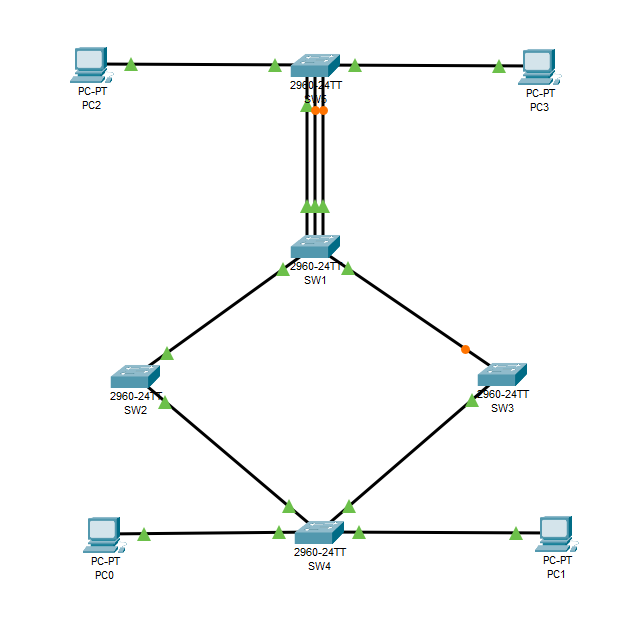

# Отчёт по лабораторной работе 1.4
**Тема:** Spanning Tree Protocol 
**Выполнили:** Малыгин А. С., Кислов И. Н., гр. 539  

## Топология
  

## Ответы на вопросы  
1. **Приведите вывод команды show spanning-tree для всех коммутаторов. На основании полученных данных определите, какой из коммутаторов выбран корнем топологии.**  
```
SW1#show spanning-tree 
VLAN0001
  Spanning tree enabled protocol ieee
  Root ID    Priority    32769
             Address     0001.97D8.739E
             Cost        4
             Port        25(GigabitEthernet0/1)
             Hello Time  2 sec  Max Age 20 sec  Forward Delay 15 sec

  Bridge ID  Priority    32769  (priority 32768 sys-id-ext 1)
             Address     00E0.F96A.BED7
             Hello Time  2 sec  Max Age 20 sec  Forward Delay 15 sec
             Aging Time  20

Interface        Role Sts Cost      Prio.Nbr Type
---------------- ---- --- --------- -------- --------------------------------
Fa0/3            Desg FWD 19        128.3    P2p
Fa0/2            Desg FWD 19        128.2    P2p
Fa0/1            Desg FWD 19        128.1    P2p
Gi0/1            Root FWD 4         128.25   P2p
Gi0/2            Desg FWD 4         128.26   P2p
\\\\\\\\\\\\\\\\\\\\\\\\\\\\\\\\\\\\\\\\\\\\\\\\\\\\\\\\\\\\\\\\\\\\\\\\\\\\\\\
SW2#sh spanning-tree 
VLAN0001
  Spanning tree enabled protocol ieee
  Root ID    Priority    32769
             Address     0001.97D8.739E
             This bridge is the root
             Hello Time  2 sec  Max Age 20 sec  Forward Delay 15 sec

  Bridge ID  Priority    32769  (priority 32768 sys-id-ext 1)
             Address     0001.97D8.739E
             Hello Time  2 sec  Max Age 20 sec  Forward Delay 15 sec
             Aging Time  20

Interface        Role Sts Cost      Prio.Nbr Type
---------------- ---- --- --------- -------- --------------------------------
Gi0/1            Desg FWD 4         128.25   P2p
Gi0/2            Desg FWD 4         128.26   P2p
\\\\\\\\\\\\\\\\\\\\\\\\\\\\\\\\\\\\\\\\\\\\\\\\\\\\\\\\\\\\\\\\\\\\\\\\\\\\\\\
SW3#sh spanning-tree 
VLAN0001
  Spanning tree enabled protocol ieee
  Root ID    Priority    32769
             Address     0001.97D8.739E
             Cost        8
             Port        26(GigabitEthernet0/2)
             Hello Time  2 sec  Max Age 20 sec  Forward Delay 15 sec

  Bridge ID  Priority    32769  (priority 32768 sys-id-ext 1)
             Address     0030.A362.6CB6
             Hello Time  2 sec  Max Age 20 sec  Forward Delay 15 sec
             Aging Time  20

Interface        Role Sts Cost      Prio.Nbr Type
---------------- ---- --- --------- -------- --------------------------------
Gi0/2            Root FWD 4         128.26   P2p
Gi0/1            Altn BLK 4         128.25   P2p
\\\\\\\\\\\\\\\\\\\\\\\\\\\\\\\\\\\\\\\\\\\\\\\\\\\\\\\\\\\\\\\\\\\\\\\\\\\\\\\
SW4#sh spanning-tree 
VLAN0001
  Spanning tree enabled protocol ieee
  Root ID    Priority    32769
             Address     0001.97D8.739E
             Cost        4
             Port        25(GigabitEthernet0/1)
             Hello Time  2 sec  Max Age 20 sec  Forward Delay 15 sec

  Bridge ID  Priority    32769  (priority 32768 sys-id-ext 1)
             Address     0002.4AA8.2107
             Hello Time  2 sec  Max Age 20 sec  Forward Delay 15 sec
             Aging Time  20

Interface        Role Sts Cost      Prio.Nbr Type
---------------- ---- --- --------- -------- --------------------------------
Fa0/11           Desg FWD 19        128.11   P2p
Fa0/10           Desg FWD 19        128.10   P2p
Gi0/1            Root FWD 4         128.25   P2p
Gi0/2            Desg FWD 4         128.26   P2p
\\\\\\\\\\\\\\\\\\\\\\\\\\\\\\\\\\\\\\\\\\\\\\\\\\\\\\\\\\\\\\\\\\\\\\\\\\\\\\\
SW5#sh spanning-tree 
VLAN0001
  Spanning tree enabled protocol ieee
  Root ID    Priority    32769
             Address     0001.97D8.739E
             Cost        23
             Port        1(FastEthernet0/1)
             Hello Time  2 sec  Max Age 20 sec  Forward Delay 15 sec

  Bridge ID  Priority    32769  (priority 32768 sys-id-ext 1)
             Address     0030.F25B.5076
             Hello Time  2 sec  Max Age 20 sec  Forward Delay 15 sec
             Aging Time  20

Interface        Role Sts Cost      Prio.Nbr Type
---------------- ---- --- --------- -------- --------------------------------
Fa0/11           Desg FWD 19        128.11   P2p
Fa0/3            Altn BLK 19        128.3    P2p
Fa0/2            Altn BLK 19        128.2    P2p
Fa0/1            Root FWD 19        128.1    P2p
Fa0/10           Desg FWD 19        128.10   P2p
```
Поскольку у SW2 все порты Designated и есть строчка ```This bridge is the root```, то это Root-коммутатор.  

**Какие коммутаторы заблокировали свои интерфейсы для построения топологии без петель? Какие роль и состояние у заблокированных интерфейсов?**  
**SW3** заблокировал интерфейс Gi0/1; Роль - Alternative, статус - Blocked  
**SW5** заблокировал интерфейсы Fa0/3 и Fa0/2. У обоих роль - Alternative и статус - Blocked  
  
2. **Приведите вывод команды show spanning-tree summary на любом из коммутаторов. В каком режиме работает протокол STP?**  
```
SW4#show spanning-tree summary 
Switch is in pvst mode
Root bridge for:
Extended system ID           is enabled
Portfast Default             is disabled
PortFast BPDU Guard Default  is disabled
Portfast BPDU Filter Default is disabled
Loopguard Default            is disabled
EtherChannel misconfig guard is disabled
UplinkFast                   is disabled
BackboneFast                 is disabled
Configured Pathcost method used is short
```
Коммутатор работает в режиме PVST+, предназначенном для более старых устройств Cisco.  
  
3. **Повторно приведите вывод команды show spanning-tree summary на любом из коммутаторов. В каком режиме работает протокол STP теперь?**  
```
SW1#sh sp sum
Switch is in rapid-pvst mode
Root bridge for:
Extended system ID           is enabled
Portfast Default             is disabled
PortFast BPDU Guard Default  is disabled
Portfast BPDU Filter Default is disabled
Loopguard Default            is disabled
EtherChannel misconfig guard is disabled
UplinkFast                   is disabled
BackboneFast                 is disabled
Configured Pathcost method used is short
```
Теперь коммутатор работает в режиме Rapid-PVST (RPVST)  
  
4. **Приведите вывод команды show spanning-tree vlan 1 на SW1, команды show spanning-tree vlan 10 на SW2 и команды show spanning-tree vlan 20 на SW3.**
```
SW1#sh sp vlan 1
VLAN0001
  Spanning tree enabled protocol rstp
  Root ID    Priority    16385
             Address     00E0.F96A.BED7
             This bridge is the root
             Hello Time  2 sec  Max Age 20 sec  Forward Delay 15 sec

  Bridge ID  Priority    16385  (priority 16384 sys-id-ext 1)
             Address     00E0.F96A.BED7
             Hello Time  2 sec  Max Age 20 sec  Forward Delay 15 sec
             Aging Time  20

Interface        Role Sts Cost      Prio.Nbr Type
---------------- ---- --- --------- -------- --------------------------------
Fa0/3            Desg FWD 19        128.3    P2p
Fa0/2            Desg FWD 19        128.2    P2p
Fa0/1            Desg FWD 19        128.1    P2p
Gi0/1            Desg FWD 4         128.25   P2p
Gi0/2            Desg FWD 4         128.26   P2p
\\\\\\\\\\\\\\\\\\\\\\\\\\\\\\\\\\\\\\\\\\\\\\\\\\\\\\\\\\\\\\\\\\\\\\\\\\\\\\\
SW2#sh sp vlan 10
VLAN0010
  Spanning tree enabled protocol rstp
  Root ID    Priority    16394
             Address     0001.97D8.739E
             This bridge is the root
             Hello Time  2 sec  Max Age 20 sec  Forward Delay 15 sec

  Bridge ID  Priority    16394  (priority 16384 sys-id-ext 10)
             Address     0001.97D8.739E
             Hello Time  2 sec  Max Age 20 sec  Forward Delay 15 sec
             Aging Time  20

Interface        Role Sts Cost      Prio.Nbr Type
---------------- ---- --- --------- -------- --------------------------------
Gi0/1            Desg FWD 4         128.25   P2p
Gi0/2            Desg FWD 4         128.26   P2p
\\\\\\\\\\\\\\\\\\\\\\\\\\\\\\\\\\\\\\\\\\\\\\\\\\\\\\\\\\\\\\\\\\\\\\\\\\\\\\\
SW3#sh sp vlan 20
VLAN0020
  Spanning tree enabled protocol rstp
  Root ID    Priority    16404
             Address     0030.A362.6CB6
             This bridge is the root
             Hello Time  2 sec  Max Age 20 sec  Forward Delay 15 sec

  Bridge ID  Priority    16404  (priority 16384 sys-id-ext 20)
             Address     0030.A362.6CB6
             Hello Time  2 sec  Max Age 20 sec  Forward Delay 15 sec
             Aging Time  20

Interface        Role Sts Cost      Prio.Nbr Type
---------------- ---- --- --------- -------- --------------------------------
Gi0/2            Desg FWD 4         128.26   P2p
Gi0/1            Desg FWD 4         128.25   P2p
```
5. **На SW5 один порт выбран корневым для всех VLAN. Какой?**  
```
SW5#sh sp
...
Interface        Role Sts Cost      Prio.Nbr Type
---------------- ---- --- --------- -------- --------------------------------
Fa0/11           Desg FWD 19        128.11   P2p
Fa0/3            Altn BLK 19        128.3    P2p
Fa0/2            Altn BLK 19        128.2    P2p
Fa0/1            Root FWD 19        128.1    P2p
Fa0/10           Desg FWD 19        128.10   P2p
```
Корневым выбран порт Fa0/1.  
**Как коммутатор выбирает корневой порт при получении нескольких BPDU с равной стоимостью и одинаковым Bridge ID соседа?**  
По минимальному приоритету, если приоритеты равны, то по минимальному номеру порта.  
  
6. **Приведите вывод команды show spanning-tree на SW5. Какие порты выбраны корневыми для VLAN1, VLAN10 и VLAN20?**
```
SW5#sh sp
VLAN0001
  Spanning tree enabled protocol rstp
  Root ID    Priority    16385
             Address     00E0.F96A.BED7
             Cost        19
             Port        1(FastEthernet0/1)
             Hello Time  2 sec  Max Age 20 sec  Forward Delay 15 sec

  Bridge ID  Priority    32769  (priority 32768 sys-id-ext 1)
             Address     0030.F25B.5076
             Hello Time  2 sec  Max Age 20 sec  Forward Delay 15 sec
             Aging Time  20

Interface        Role Sts Cost      Prio.Nbr Type
---------------- ---- --- --------- -------- --------------------------------
Fa0/11           Desg FWD 19        128.11   P2p
Fa0/3            Altn BLK 19        128.3    P2p
Fa0/2            Altn BLK 19        128.2    P2p
Fa0/1            Root FWD 19        128.1    P2p
Fa0/10           Desg FWD 19        128.10   P2p

VLAN0010
  Spanning tree enabled protocol rstp
  Root ID    Priority    16394
             Address     0001.97D8.739E
             Cost        23
             Port        2(FastEthernet0/2)
             Hello Time  2 sec  Max Age 20 sec  Forward Delay 15 sec

  Bridge ID  Priority    32778  (priority 32768 sys-id-ext 10)
             Address     0030.F25B.5076
             Hello Time  2 sec  Max Age 20 sec  Forward Delay 15 sec
             Aging Time  20

Interface        Role Sts Cost      Prio.Nbr Type
---------------- ---- --- --------- -------- --------------------------------
Fa0/11           Desg FWD 19        128.11   P2p
Fa0/3            Altn BLK 19        128.3    P2p
Fa0/2            Root FWD 19        128.2    P2p
Fa0/1            Altn BLK 19        128.1    P2p
Fa0/10           Desg FWD 19        128.10   P2p

VLAN0020
  Spanning tree enabled protocol rstp
  Root ID    Priority    16404
             Address     0030.A362.6CB6
             Cost        14
             Port        3(FastEthernet0/3)
             Hello Time  2 sec  Max Age 20 sec  Forward Delay 15 sec

  Bridge ID  Priority    32788  (priority 32768 sys-id-ext 20)
             Address     0030.F25B.5076
             Hello Time  2 sec  Max Age 20 sec  Forward Delay 15 sec
             Aging Time  20

Interface        Role Sts Cost      Prio.Nbr Type
---------------- ---- --- --------- -------- --------------------------------
Fa0/11           Desg FWD 19        128.11   P2p
Fa0/3            Root FWD 10        128.3    P2p
Fa0/2            Altn BLK 19        128.2    P2p
Fa0/1            Altn BLK 19        128.1    P2p
Fa0/10           Desg FWD 19        128.10   P2p
```
VLAN 1: Root-портом является интерфейс Fa0/1  
VLAN 10: Root-портом является интерфейс Fa0/2  
VLAN 20: Root-портом является интерфейс Fa0/3  
**Проверьте связность между PC0 и PC2, между PC1 и PC3 при помощи утилиты ping. Если ping не проходит, перепроверьте правильность выполнения предыдущих этапов.**  
```
PC0:
C:\>ping 192.168.10.102

Pinging 192.168.10.102 with 32 bytes of data:

Reply from 192.168.10.102: bytes=32 time<1ms TTL=128
Reply from 192.168.10.102: bytes=32 time<1ms TTL=128
Reply from 192.168.10.102: bytes=32 time<1ms TTL=128
Reply from 192.168.10.102: bytes=32 time<1ms TTL=128

Ping statistics for 192.168.10.102:
    Packets: Sent = 4, Received = 4, Lost = 0 (0% loss),
Approximate round trip times in milli-seconds:
    Minimum = 0ms, Maximum = 0ms, Average = 0ms

PC1:
C:\>ping 192.168.20.102

Pinging 192.168.20.102 with 32 bytes of data:

Reply from 192.168.20.102: bytes=32 time<1ms TTL=128
Reply from 192.168.20.102: bytes=32 time<1ms TTL=128
Reply from 192.168.20.102: bytes=32 time<1ms TTL=128
Reply from 192.168.20.102: bytes=32 time<1ms TTL=128

Ping statistics for 192.168.20.102:
    Packets: Sent = 4, Received = 4, Lost = 0 (0% loss),
Approximate round trip times in milli-seconds:
    Minimum = 0ms, Maximum = 0ms, Average = 0ms
```
7. **Используйте команду show spanning-tree interface Fa0/10 detail на SW4, чтобы убедиться в том, что интерфейс работает в режиме Portfast.**  
```
SW4#sh spanning-tree int fa0/10 detail


Port 10 (FastEthernet0/10) of VLAN0001 is designated forwarding
  The port is in the portfast mode
Port 10 (FastEthernet0/10) of VLAN0010 is designated forwarding
  The port is in the portfast mode
Port 10 (FastEthernet0/10) of VLAN0020 is designated forwarding
  The port is in the portfast mode
```
**Какую команду надо использовать, чтобы перевести магистральный интерфейс в режим Portfast? При подключении каких устройств так можно делать и при каких строго не рекомендуется?**  
Для перевода транк-интерфейса в режим portfast выполняется команда ```Switch(config-if)# spanning-tree portfast trunk```. Использовать рекомендуется строго для устройств, у которых нет коммутатора на другом конце. Если транк-порт коммутатора соединяет другие коммутаторы, то переводить интерфейс в portfast не рекомендуется, т.к. это приведёт к появлению петли маршрутизации.  
  
8. **Используйте команду show interface Fa0/4 на коммутаторе SW1, приведите её вывод. В каком состоянии находится интерфейс? Опишите, какое событие привело порт в это состояние.**  
```
SW1#sh int fa0/4
FastEthernet0/4 is down, line protocol is down (err-disabled)
  Hardware is Lance, address is 00e0.b04b.d804 (bia 00e0.b04b.d804)
 BW 100000 Kbit, DLY 1000 usec,
     reliability 255/255, txload 1/255, rxload 1/255
  Encapsulation ARPA, loopback not set
  Keepalive set (10 sec)
  Full-duplex, 100Mb/s
  input flow-control is off, output flow-control is off
  ARP type: ARPA, ARP Timeout 04:00:00
  Last input 00:00:08, output 00:00:05, output hang never
  Last clearing of "show interface" counters never
  Input queue: 0/75/0/0 (size/max/drops/flushes); Total output drops: 0
  Queueing strategy: fifo
  Output queue :0/40 (size/max)
  5 minute input rate 0 bits/sec, 0 packets/sec
  5 minute output rate 0 bits/sec, 0 packets/sec
     956 packets input, 193351 bytes, 0 no buffer
     Received 956 broadcasts, 0 runts, 0 giants, 0 throttles
     0 input errors, 0 CRC, 0 frame, 0 overrun, 0 ignored, 0 abort
     0 watchdog, 0 multicast, 0 pause input
     0 input packets with dribble condition detected
     2357 packets output, 263570 bytes, 0 underruns
     0 output errors, 0 collisions, 10 interface resets
     0 babbles, 0 late collision, 0 deferred
     0 lost carrier, 0 no carrier
     0 output buffer failures, 0 output buffers swapped out
```  
На Интерфейсе Fa0/4 включен BPDU Guard, блокирующий получение любых BPDU на этот интерфейс.  

9. **Используйте команду show spanning-tree inconsistentports на коммутаторе SW1 для просмотра несогласованных портов, приведите её вывод. Какой интерфейс там есть? Опишите, какое событие привело интерфейс в это состояние.**  
```
SW1#sh spa incon
Name                 Interface            Inconsistency
-------------------- -------------------- ------------------
VLAN0001             FastEthernet0/5      Root Inconsistent

Number of inconsistent ports (segments) in the system : 1
```
Интерфейс Fa0/5 находится в состоянии root-inconsistent, т.к. на нём включен root guard. С SW6 приходит более выгодный BPDU, заявляющий SW6 - корневым коммутатором, поэтому root guard блокирует порт, запрещая ему участвовать в определении Root-коммутатора.