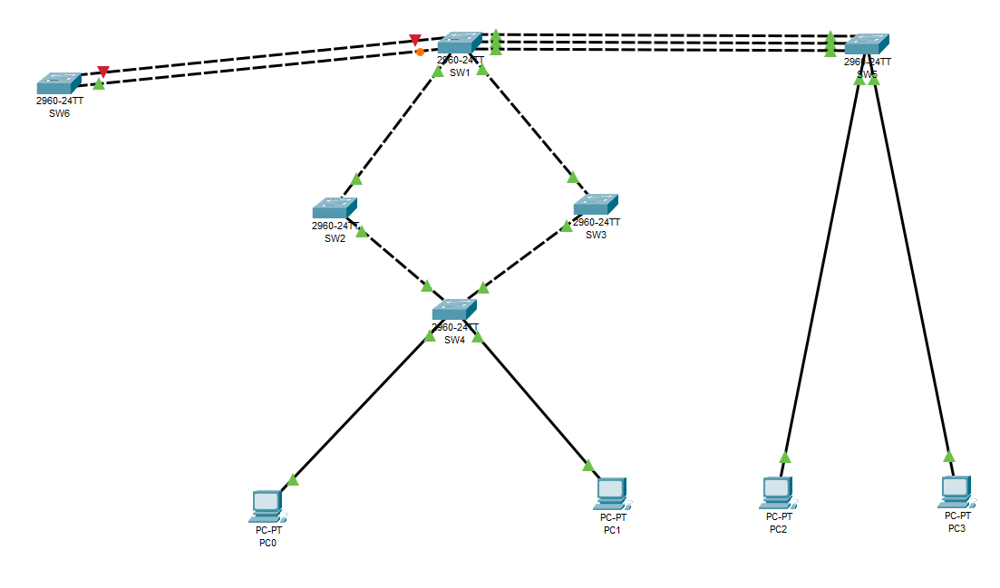

# Отчет по лабораторной работе 4
**Тема:** Spanning Tree Protocol  
**Выполнил:** Пьянов Никита 439 группа  
**Специальность:** 09.02.06 «Сетевое и системное администрирование»  

---

## Топология

---

## Часть 1: Создание топологии и начальная конфигурация устройств

Собрана топология согласно заданию. На всех коммутаторах выполнена базовая настройка: задан hostname, отключен поиск DNS (`no ip domain-lookup`), включена синхронизация вывода на консоли (`logging synchronous`). На ПК PC0–PC3 настроены статические IP-адреса.

---

## Часть 2: Анализ дерева STP "по-умолчанию"

### 📌 Вопрос 1
**Приведите вывод команды `show spanning-tree` для всех коммутаторов. На основании полученных данных определите, какой из коммутаторов выбран корнем топологии.**
**Ответ:** Корневым коммутатором (Root Bridge) выбран **SW4**. Это видно по выводу команды на самом SW4, где присутствует строка `This bridge is the root`, а его Bridge ID (`0001.6326.7326`) совпадает с Root ID во всей топологии. Так как приоритеты у всех коммутаторов по умолчанию равны (32768), выборы прошли по наименьшему MAC-адресу, который оказался у SW4.
*(Вставь скриншоты `show spanning-tree` для SW1-SW5)*

**Какие коммутаторы заблокировали свои интерфейсы для построения топологии без петель? Какие роль и состояние у заблокированных интерфейсов?**
**Ответ:** Порты заблокировали коммутаторы **SW1** и **SW5**. 
* На SW1 заблокирован интерфейс **Gi0/1**.
* На SW5 заблокированы интерфейсы **Fa0/2** и **Fa0/3**.
У этих портов роль **Altn (Alternate)**, а состояние **BLK (Blocking)**. Это произошло потому, что между SW1 и SW5 проложено три параллельных линка, образующих петлю. STP оставил для пересылки трафика только один (Fa0/1 на SW5), а остальные заблокировал.

---

## Часть 3: Настройка STP

### Шаг 1: Настройка быстрого STP

### 📌 Вопрос 2
**Приведите вывод команды `show spanning-tree summary` на любом из коммутаторов. В каком режиме работает протокол STP?**
**Ответ:** Протокол STP работает в режиме **PVST** (Per-VLAN Spanning Tree). Это видно по строке `Switch is in pvst mode` в выводе команды.
*(Вставь скриншот)*

### 📌 Вопрос 3
**Повторно приведите вывод команды `show spanning-tree summary`. В каком режиме работает протокол STP теперь?**
**Ответ:** Теперь протокол работает в режиме **Rapid PVST+**. Это видно по строке `Switch is in rapid-pvst mode` в выводе команды. Данный режим обеспечивает более быструю сходимость сети (за секунды) по сравнению с классическим 802.1D.
*(Вставь скриншот)*

### Шаг 2 и 3: VLAN, транки и приоритеты Bridge ID

### 📌 Вопрос 4
**Приведите вывод команды `show spanning-tree vlan 1` на SW1, команды `show spanning-tree vlan 10` на SW2 и команды `show spanning-tree vlan 20` на SW3.**
**Ответ:** С помощью изменения приоритета STP мы вручную назначили разных корневых коммутаторов для разных VLAN. На SW1 для VLAN 1, на SW2 для VLAN 10 и на SW3 для VLAN 20 в выводах команд присутствует строка `This bridge is the root`, что подтверждает успешное управление выборами корневого моста.
*(Вставь три скриншота)*

### Шаг 4: Управление выборами корневого порта

### 📌 Вопрос 5
**На SW5 один порт выбран корневым для всех VLAN. Какой?**
**Ответ:** До внесения изменений (по умолчанию) на SW5 корневым портом (Root Port) для всех VLAN был выбран **Fa0/1** (так как он имеет наименьший Port ID среди всех портов, подключенных к SW1).

**Как коммутатор выбирает корневой порт при получении нескольких BPDU с равной стоимостью и одинаковым Bridge ID соседа?**
**Ответ:** Если стоимости путей равны и Bridge ID соседей одинаковы, коммутатор сравнивает **Port ID вышестоящего (соседнего) коммутатора**. Port ID состоит из приоритета порта (Port Priority) и номера порта. Побеждает тот порт, у которого Port ID меньше (сначала сравнивается приоритет, затем номер порта). Если и они равны, сравнивается локальный Port ID.

### 📌 Вопрос 6
**Приведите вывод команды `show spanning-tree` на SW5. Какие порты выбраны корневыми для VLAN1, VLAN10 и VLAN20?**
**Ответ:** В результате ручной настройки корневые порты на SW5 распределились следующим образом:
* Для **VLAN 1** — **Fa0/1** (приоритеты и стоимости не менялись).
* Для **VLAN 10** — **Fa0/2** (так как на SW1 мы понизили приоритет этого порта до 112, сделав его более предпочтительным).
* Для **VLAN 20** — **Fa0/3** (так как мы понизили стоимость этого порта до 10, сделав путь через него самым коротким до корня SW3).
*(Вставь скриншоты вывода)*
*(Вставь скриншот успешного пинга PC0 -> PC2)*

---

## Часть 4: Настройка и проверка дополнительного функционала STP

### 📌 Вопрос 7
**Используйте команду `show spanning-tree interface Fa0/10 detail` на SW4, чтобы убедиться в том, что интерфейс работает в режиме Portfast.**
**Ответ:** В выводе команды присутствует строка `The port is in the portfast mode`, что подтверждает успешное включение режима PortFast.
*(Вставь скриншот)*

**Какую команду надо использовать, чтобы перевести магистральный интерфейс в режим Portfast? При подключении каких устройств так можно делать и при каких строго не рекомендуется?**
**Ответ:** Для перевода магистрального интерфейса в режим Portfast используется команда **`spanning-tree portfast trunk`**. Это допустимо делать только для транковых портов, к которым подключены конечные устройства (например, IP-телефоны, точки доступа Wi-Fi, серверы). **Строго не рекомендуется** делать это на портах, соединяющих коммутаторы, так как это может привести к образованию петель и широковещательному шторму.

### 📌 Вопрос 8
**Используйте команду `show interface Fa0/4` на коммутаторе SW1, приведите её вывод. В каком состоянии находится интерфейс? Опишите, какое событие привело порт в это состояние.**
**Ответ:** Интерфейс находится в состоянии **`down (err-disabled)`**. Это состояние вызвано срабатыванием механизма **BPDU Guard**. Мы подключили к порту Fa0/4 (на котором включен BPDU Guard и PortFast) другой коммутатор (SW6), на порт начали приходить BPDU-сообщения. BPDU Guard расценил это как нарушение безопасности и административно выключил порт для предотвращения петли.
*(Вставь скриншот)*

### 📌 Вопрос 9
**Используйте команду `show spanning-tree inconsistentports` на коммутаторе SW1 для просмотра несогласованных портов, приведите её вывод. Какой интерфейс там есть? Опишите, какое событие привело интерфейс в это состояние.**
**Ответ:** В выводе указан интерфейс **Fa0/5** (состояние `Root Inconsistent`). Это состояние вызвано срабатыванием механизма **Root Guard**. Коммутатор SW6 имеет приоритет 4096 и пытается стать корневым, рассылая более выгодные BPDU. Root Guard на SW1 перехватывает эти BPDU и блокирует порт (переводя его в root-inconsistent), чтобы защитить текущего корневого коммутатора топологии от перехвата власти.
*(Вставь скриншот)*

---

## Вывод
В ходе лабораторной работы было изучено построение топологии без петель с помощью протокола STP. Были проанализированы выборы корневого коммутатора по умолчанию, освоено управление выборами с помощью изменения приоритета Bridge ID и приоритета/стоимости портов, а также настроены механизмы защиты PortFast, BPDU Guard и Root Guard для предотвращения несанкционированного изменения топологии.