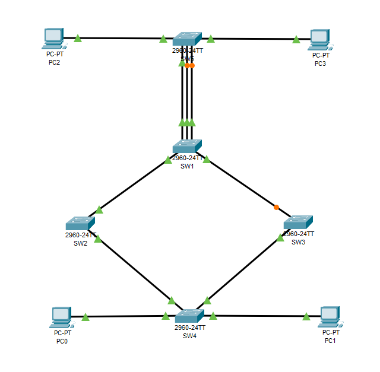
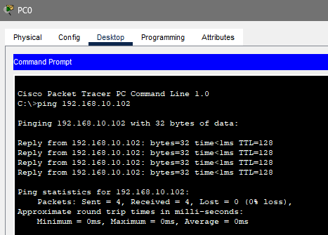

# Отчет по лабораторной работе 4
**Тема:** Spanning Tree Protocol  
**Выполнил:** Пьянов Никита 439 группа  
**Специальность:** 09.02.06 «Сетевое и системное администрирование»  

## Топология сети


## Анализ дерева STP по умолчанию
После сборки топологии было изучено дерево STP, сформированное без вмешательства. С помощью команды `show spanning-tree` на всех коммутаторах я определил, что корневым коммутатором (Root Bridge) выбран **SW4**. На это указывает строка `This bridge is the root` и совпадение его Bridge ID (`0001.6326.7326`) с Root ID во всей топологии:

```text
SW4# show spanning-tree
VLAN0001
  Spanning tree enabled protocol rstp
  Root ID    Priority    32769
             Address     0001.6326.7326
             This bridge is the root
             Cost        0
...
```

Так как приоритеты у всех коммутаторов по умолчанию были равны (32768), выборы прошли по наименьшему MAC-адресу.

Из-за наличия параллельных линков между SW1 и SW5 образовалась петля, поэтому STP заблокировал избыточные порты. На SW1 заблокирован интерфейс Gi0/1, а на SW5 — интерфейсы Fa0/2 и Fa0/3. У этих портов роль `Altn` (Alternate), а состояние `BLK` (Blocking). Например, это видно в выводе на SW1:

```text
SW1# show spanning-tree
...
Interface           Role Sts Cost      Prio.Nbr Type
------------------- ---- --- --------- -------- ----
Gi0/2               Root FWD 4         128.26   P2p
Gi0/1               Altn BLK 4         128.25   P2p
...
```

## Настройка STP
Изначально протокол работал в режиме PVST, что подтверждается выводом команды:
```text
SW1# show spanning-tree summary
Switch is in pvst mode
Root bridge for: 
...
```

На всех коммутаторах режим был изменен на **Rapid PVST+** командой `spanning-tree mode rapid-pvst`. Проверка показала успешное переключение:
```text
SW1# show spanning-tree summary
Switch is in rapid-pvst mode
Root bridge for: 
...
```

Далее были созданы VLAN 10 (STUDENTS) и VLAN 20 (TEACHERS), а межкоммутаторные порты переведены в режим trunk. С помощью изменения приоритета Bridge ID были вручную назначены корневые коммутаторы для разных VLAN: SW1 для VLAN 1, SW2 для VLAN 10 и SW3 для VLAN 20. На каждом из них в выводе команды присутствует подтверждающая строка.

Пример для SW2 (VLAN 10):
```text
SW2# show spanning-tree vlan 10
VLAN0010
  Spanning tree enabled protocol rstp
  Root ID    Priority    16394
             Address     0010.11AC.B687
             This bridge is the root
...
```
*(Аналогичные выводы получены на SW1 для vlan 1 и на SW3 для vlan 20)*

## Управление выборами корневого порта
По умолчанию на SW5 корневым портом для всех VLAN был выбран Fa0/1 (так как он имеет наименьший Port ID среди соседей). Если коммутатор получает несколько BPDU с равной стоимостью и одинаковым Bridge ID соседа, выбор делается по Port ID вышестоящего коммутатора (сначала приоритет, затем номер порта).

Для изменения топологии на SW1 приоритет порта Fa0/2 для VLAN 10 был понижен до 112, а на SW5 стоимость порта Fa0/3 для VLAN 20 снижена до 10. В результате на SW5 корневые порты распределились так:

```text
SW5# show spanning-tree
VLAN0001
...
Fa0/1               Root FWD 19        128.1    P2p
VLAN0010
...
Fa0/2               Root FWD 19        128.2    P2p
VLAN0020
...
Fa0/3               Root FWD 10        128.3    P2p
```

Проверка связности между PC0 и PC2 прошла успешно:


## Дополнительный функционал STP
На портах доступа (Fa0/10, Fa0/11 на SW4 и SW5) были включены функции PortFast и BPDU Guard. Проверка показала, что интерфейс Fa0/10 работает в режиме PortFast:
```text
SW4# show spanning-tree interface Fa0/10 detail
...
The port is in the portfast mode
...
```
Для перевода магистрального интерфейса в PortFast используется команда `spanning-tree portfast trunk`. Это допустимо только для портов, подключенных к конечным устройствам (серверы, IP-телефоны, точки доступа). На портах между коммутаторами так делать строго не рекомендуется во избежание петель.

Для проверки защиты к SW1 был подключен новый коммутатор SW6. 
1. При подключении SW6 к порту Fa0/4 (на котором настроен BPDU Guard) интерфейс ушел в состояние `err-disabled`, так как начали приходить BPDU-сообщения:
```text
SW1# show interface Fa0/4
FastEthernet0/4 is down, line protocol is down (err-disabled)
...
```
2. На порту Fa0/5 был настроен Root Guard. SW6 имел приоритет 4096 и пытался стать корнем, но Root Guard заблокировал порт:
```text
SW1# show spanning-tree inconsistentports
Name                 Interface                Inconsistency
-------------------- ------------------------ ------------------
VLAN0001             FastEthernet0/5          Root Inconsistent
```

## Вывод
В ходе работы были изучены принципы работы протокола STP, произведена настройка Rapid PVST+, управление выборами корневого моста с помощью приоритетов, а также изучено влияние параметров портов на выбор корневого пути. Были настроены и проверены механизмы защиты PortFast, BPDU Guard и Root Guard.